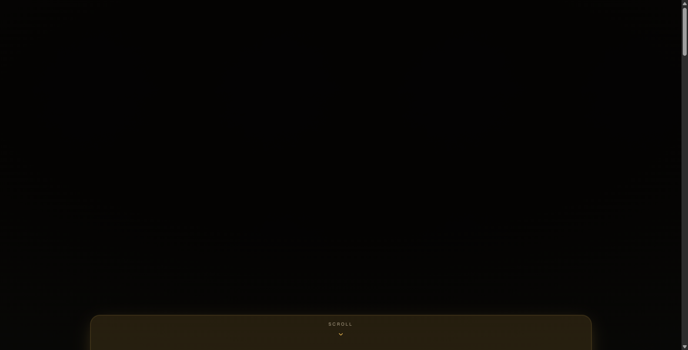
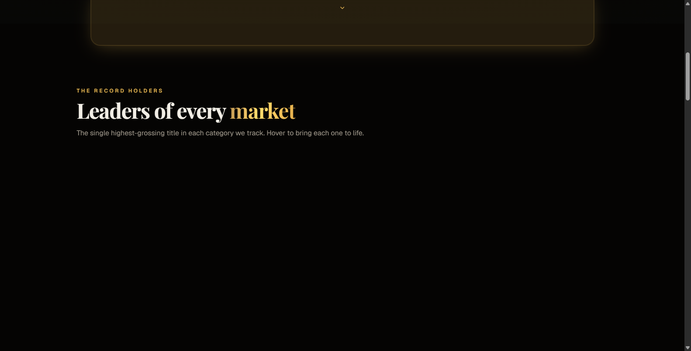
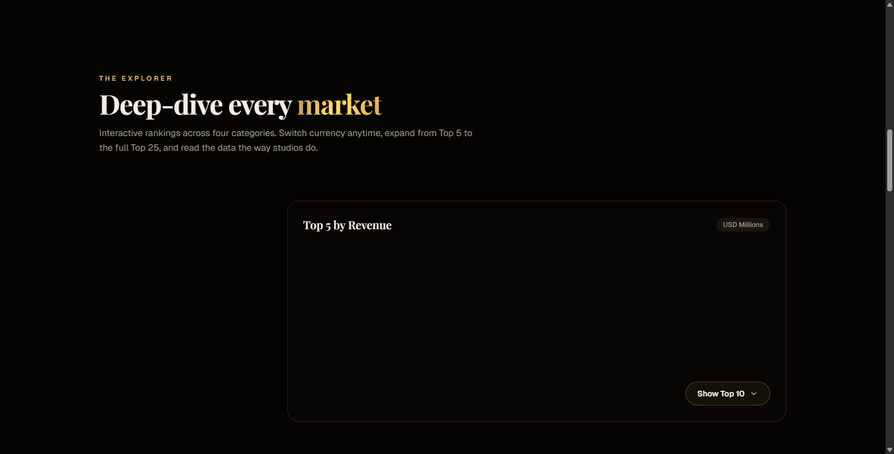

# Box-office

<p align="center">
  
  
  
  
  
</p>

An interactive, modern cinematic box office intelligence dashboard featuring global movie rankings, currency conversion, studio market share analytics, and 3D ambient visuals.

---

## 📸 Hero Preview

<p align="center">
  
</p>

## 🖼️ UI Snapshot Gallery

<p align="center">
  
  
</p>

---

## ✨ Features

- 🎬 **Cinematic Box Office Intelligence** - Real-time film economics, global rankings, and studio gross analysis.
- 🌐 **Interactive Market Explorer** - Filter top-grossing films across international markets, franchises, and release eras.
- 💱 **Live Currency Switching** - Instant conversion across major global currencies (USD, EUR, GBP, JPY, INR).
- ✨ **Fluid Motion & 3D Ambient Visuals** - Powered by Three.js / React Three Fiber and Framer Motion micro-interactions.
- 📊 **Deep Studio Analytics** - Studio market share breakdowns and financial milestone metrics.
- 📱 **Fully Responsive** - Flawless dark-mode cinematic aesthetic across mobile, tablet, and desktop viewports.

---

## 🛠️ Tech Stack

- **Framework**: Next.js 16 (App Router)
- **Frontend**: React 19, TypeScript
- **3D & Animations**: Three.js, React Three Fiber (`@react-three/fiber`), Framer Motion
- **Styling**: Tailwind CSS v4, Lucide Icons, Shadcn UI
- **Data Visualizations**: Recharts

---

## 🚀 Quick Start

### 1. Clone the repository
```bash
git clone https://github.com/soorajstudio/Box-office.git
cd Box-office
```

### 2. Install dependencies & run development server
```bash
npm install
npm run dev
```

Open [http://localhost:3000](http://localhost:3000) in your browser.

---

## 📄 License

This project is licensed under the MIT License — see the [LICENSE](LICENSE) file for details.

Developed with ❤️ by [Sooraj Studio](https://github.com/soorajstudio).
